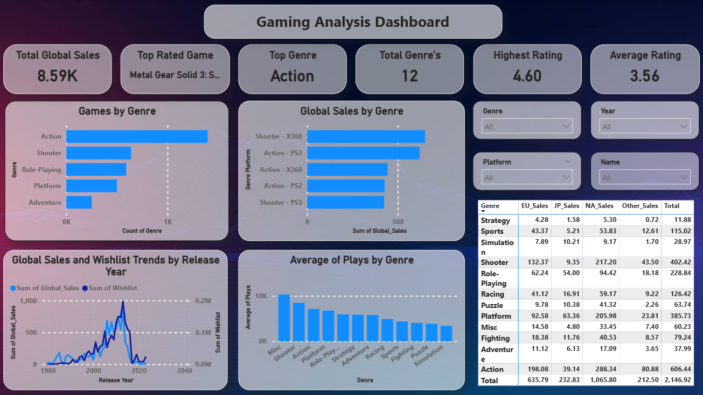

# 🎮 Video Game Sales and Engagement Analysis

An exploratory data analysis project that investigates historical video game sales, genre performance, platform trends, regional preferences, and player engagement, supported by an interactive Power BI dashboard.

## 📌 Project Overview

The video game industry can be studied from two complementary perspectives: commercial performance and player engagement. This project analyzes historical video game sales alongside engagement indicators to explore patterns in how games perform and how audiences interact with them.

Using Python for Exploratory Data Analysis (EDA) and Power BI for dashboard visualization, this project transforms raw datasets into visual insights that can help identify trends, compare performance, and generate questions for further investigation.

## 🎯 Project Objectives

- Analyze global video game sales across different genres and platforms.
- Compare sales performance across North America, Europe, Japan, and other regions.
- Identify games and platforms with notable historical sales.
- Explore player engagement through ratings, reviews, plays, backlogs, and wishlists.
- Investigate relationships between sales and engagement where titles can be matched.
- Present key findings through Python visualizations and a Power BI dashboard.

## 🛠️ Tools and Technologies

- **Python** — data analysis and exploration
- **Pandas** — data cleaning, manipulation, and aggregation
- **NumPy** — numerical operations
- **Matplotlib** — data visualization
- **Seaborn** — statistical visualization
- **Jupyter Notebook** — analysis workflow and documentation
- **Microsoft Power BI** — interactive dashboard and visual reporting
- **GitHub** — project version control and portfolio presentation

## 📂 Project Files

| File | Description |
|---|---|
| `Video_Game_Sales_and_Engagement_Analysis.ipynb` | Python EDA notebook containing data preparation, visualizations, interpretations, findings, and conclusions |
| `vgsales.csv` | Historical video game sales data, including genres, platforms, publishers, regional sales, and global sales |
| `games.csv` | Game metadata and engagement indicators, including ratings, reviews, plays, backlogs, and wishlists |
| `Merged_VGSales_Games.csv` | Combined dataset used to explore sales and engagement across matched titles |
| `Gaming Analysis Dashboard.pbix` | Power BI dashboard file |
| `Dashboard.png` | Dashboard preview image |

## 📊 Exploratory Data Analysis

The Python notebook explores the following areas:

### 1. Sales Performance
- Global sales by genre
- Average global sales per game
- Top-selling video games
- Sales distribution across platforms
- Platform and genre comparisons

### 2. Regional Analysis
- Sales across North America, Europe, Japan, and other regions
- Regional differences in genre performance
- Comparison of geographical sales contributions

### 3. Player Engagement
- Games with high recorded play counts
- Games with high wishlists
- Rating and review distributions
- Engagement comparisons across genres and developer teams
- Release trends and engagement patterns

### 4. Sales and Engagement Comparison
The project attempts to match game titles across the sales and engagement datasets to investigate possible relationships between commercial performance and player activity.

These comparisons are exploratory because the datasets differ in coverage, and title matching may not capture every edition, remake, or differently named release.

## 📈 Power BI Dashboard

The project also includes a Power BI dashboard designed to present video game analysis in a visual and accessible format.

**Dashboard Preview**

**Power BI file:** `Gaming Analysis Dashboard.pbix`

To explore the dashboard interactively, download the `.pbix` file from this repository and open it using Microsoft Power BI Desktop.

## 🔍 Key Findings

- **Genre performance varies:** Action games have the highest cumulative global sales in the historical sales dataset, while Sports and Shooter genres also make substantial contributions.
- **Average sales provide additional context:** A genre with high cumulative sales does not necessarily have the highest average sales per recorded game.
- **Platform records differ:** Platforms have different numbers of recorded games, so catalogue size should not be confused with profitability or current popularity.
- **Regional preferences vary:** North America and Europe contribute strongly to several genres, while Role-Playing games have a comparatively strong contribution in Japan.
- **Engagement has multiple dimensions:** Ratings, plays, backlogs, and wishlists provide different perspectives on audience activity and should be interpreted together rather than interchangeably.
- **Data matching requires care:** Differences in title names and dataset coverage limit the reliability and completeness of direct sales-to-engagement comparisons.

## 💡 Business Insights

The analysis provides a foundation for further investigation into genre strategy, historical platform performance, and regional audience preferences.

- Compare cumulative sales, average sales, and the number of recorded games before evaluating genre performance.
- Consider regional differences when investigating localization and marketing opportunities.
- Use engagement measures alongside sales data to develop a broader understanding of audience interest.
- Validate title matches and investigate unmatched records before drawing conclusions about individual games.
- Combine these findings with current market data, revenue, development costs, marketing expenditure, and player retention before making commercial decisions.

## 🔄 Project Workflow

1. Load and inspect the sales and engagement datasets.
2. Review missing values, data types, and data quality.
3. Clean selected fields and prepare engagement measures for analysis.
4. Perform exploratory analysis on the datasets separately.
5. Create charts to compare sales, genres, platforms, regions, and engagement.
6. Standardize game titles and attempt to merge the datasets.
7. Interpret visualizations and document potential business implications.
8. Summarize findings, limitations, and recommendations.
9. Present the analysis through a Power BI dashboard.

## ⚠️ Limitations

- The sales dataset represents historical records rather than the current market.
- Missing values and data-cleaning decisions may affect some findings.
- The two datasets may cover different games, periods, and audiences.
- Title matching may fail for editions, remakes, abbreviations, and alternative names.
- Sales volume does not equal profit, and engagement indicators do not guarantee purchases or future success.
- The analysis identifies patterns and associations, it does not establish causation.

## 🏁 Conclusion

This project demonstrates how Exploratory Data Analysis and business intelligence tools can be combined to understand video game sales and player engagement. The analysis highlights differences across genres, platforms, and regions while showing how ratings, plays, backlogs, and wishlists can provide complementary insights into audience activity.

By combining Python-based analysis with Power BI visualization, the project builds a foundation for evidence-based exploration of the video game market. It also strengthened my practical understanding of data cleaning, aggregation, visualization, data merging, and communicating findings through clear, structured analysis.

## 👨‍💻 Skills Demonstrated

- Data cleaning and preprocessing
- Exploratory Data Analysis
- Data aggregation and comparison
- Data visualization
- Regional and genre-level analysis
- Dataset merging and data quality assessment
- Business insight development
- Power BI dashboard reporting
- Project documentation using GitHub

---

**Project:** Video Game Sales and Engagement Analysis  
**Tools:** Python, Pandas, NumPy, Matplotlib, Seaborn, Jupyter Notebook, Power BI  
**Focus:** Historical sales analysis, player engagement, and business insights
